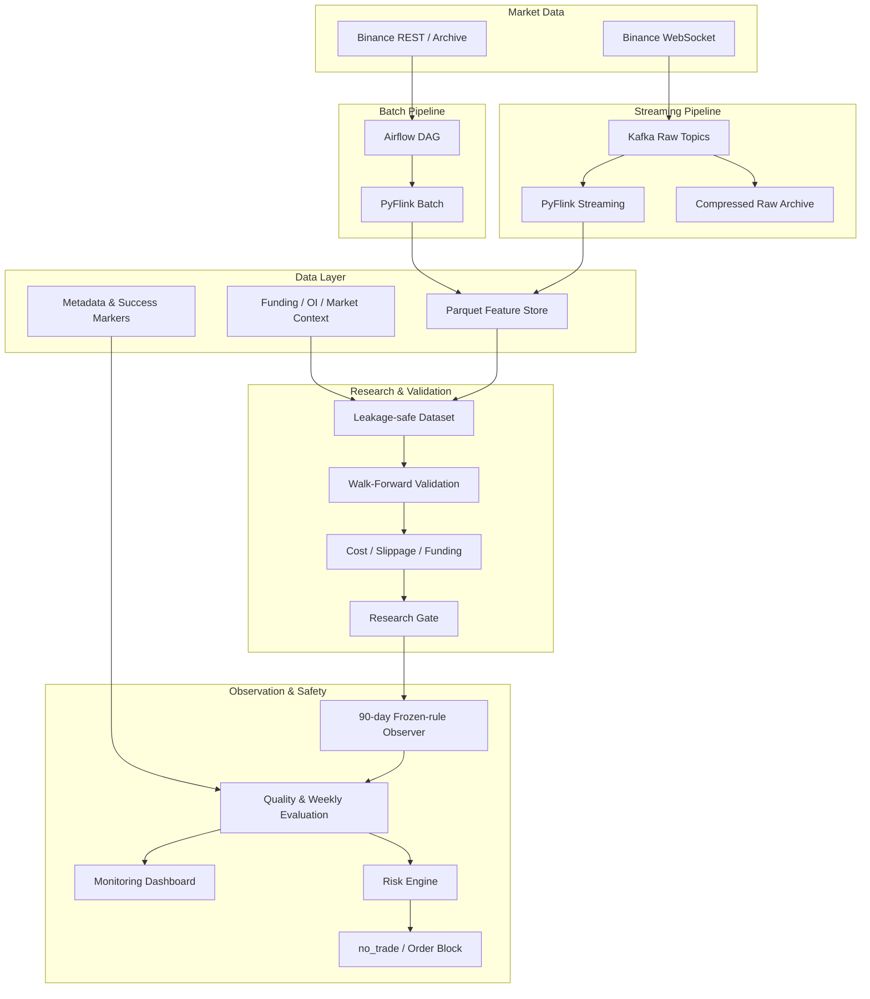
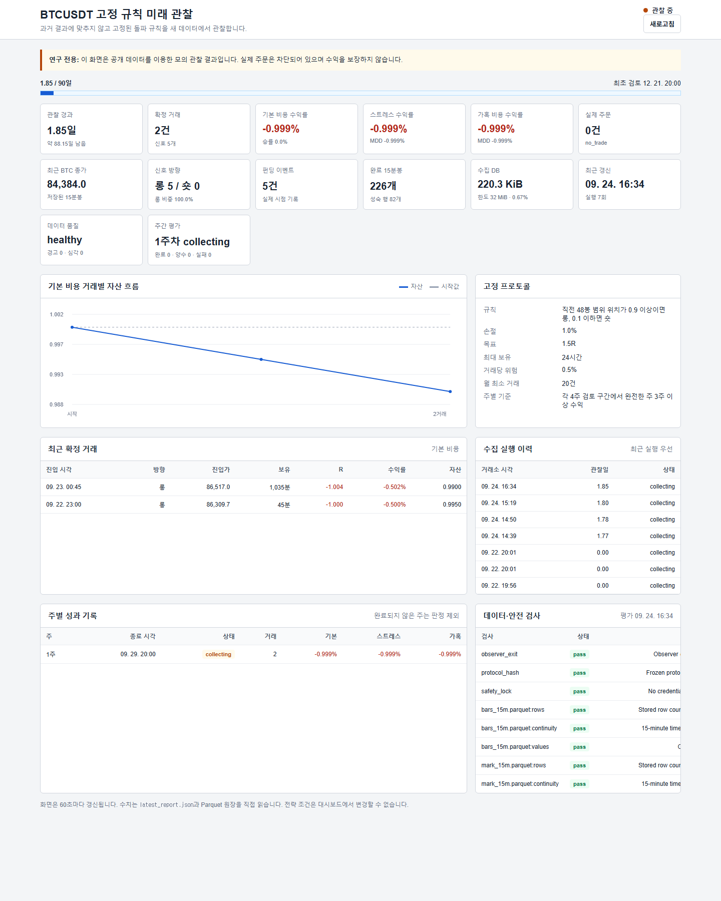
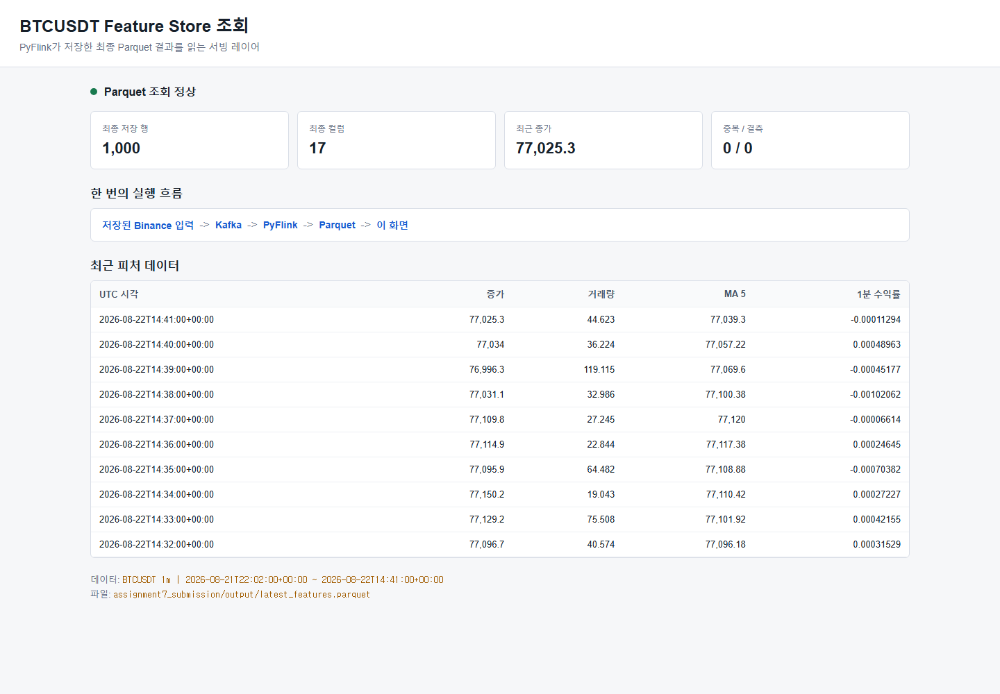

# 암호화폐 시장 데이터·전략 검증 플랫폼

> **Airflow, Kafka, Flink, Parquet 기반으로 BTCUSDT 시장 데이터를 수집·가공하고,  
> 시계열 누수와 거래비용을 통제한 Walk-Forward 검증 및 미래 관찰까지 연결한 데이터·MLOps 프로젝트**


| 구분 | 내용 |
| --- | --- |
| 프로젝트 기간 | 2026.08 ~ 진행 중 |
| 대상 시장 | Binance USDT-M Futures, BTCUSDT |
| 주요 기술 | Python, Apache Kafka, Apache Flink, Apache Airflow, Docker Compose, Parquet, SQLite |
| 담당 범위 | 데이터 수집, 스트리밍·배치 처리, Feature Store, 전략 검증, 리스크 통제, 모니터링, 테스트 |
| 현재 상태 | 연구·미래 관찰 단계 (`no_trade`) |
| 실제 주문 | 0건 |
| 검증 상태 | 승인 모델 0개, 자동 배포 차단 |

## 1. 프로젝트 요약

암호화폐 자동매매에서 어려운 문제는 매수·매도 신호 자체보다 **신뢰할 수 있는 데이터를 지속적으로 만들고, 과적합된 전략이 실거래로 넘어가지 않도록 통제하는 것**이라고 판단했습니다.

이 프로젝트에서는 Binance의 과거·실시간 시장 데이터를 수집한 뒤 Kafka와 Flink로 처리하고, Parquet Feature Store에 저장하는 파이프라인을 구현했습니다. 그 위에서 거래비용, 슬리피지, 펀딩비, 최대 낙폭을 반영한 Walk-Forward 검증을 수행했습니다. 개발 데이터에서 일부 양수였던 전략도 바로 배포하지 않고 규칙을 고정한 90일 미래 관찰 단계로 분리했습니다.

현재 미래 관찰 결과는 손실입니다. 시스템은 이를 숨기거나 재튜닝하지 않고 `no_trade`로 판정하여 실제 주문을 계속 차단하고 있습니다. 이 프로젝트의 핵심 결과는 “수익 모델 완성”이 아니라 **데이터 품질, 재현 가능한 실험, 실패 기록, 안전한 배포 판단을 하나의 흐름으로 구현한 것**입니다.

## 2. 해결하려던 문제

초기에는 공개 OHLCV 데이터로 방향성 모델과 백테스트를 구성했지만 다음 문제가 확인됐습니다.

- 분류 정확도가 실제 비용 차감 후 수익으로 이어지지 않았습니다.
- 같은 기간에서 반복적으로 조건을 조정하면 과적합 위험이 커졌습니다.
- 거래비용과 슬리피지 가정을 조금만 강화해도 수익이 사라졌습니다.
- 배치와 실시간 경로가 다른 값을 만들면 연구 결과를 운영에 재현할 수 없습니다.
- 결과가 좋다는 이유만으로 실거래까지 자동 연결하면 손실 위험이 커집니다.

따라서 목표를 단순한 예측 모델 개발에서 다음과 같이 확장했습니다.

1. 과거·실시간 데이터를 동일한 계약과 메타데이터로 관리합니다.
2. 배치와 스트리밍 특성 계산의 일관성을 검증합니다.
3. 시간 순서를 보존한 검증으로 미래 정보 누수를 방지합니다.
4. 비용 조건별 성과와 데이터 품질을 함께 평가합니다.
5. 모든 기준을 통과하지 못한 모델은 주문 단계로 이동하지 못하게 합니다.

## 3. 시스템 아키텍처



### 처리 흐름

- **배치:** 날짜와 종목을 입력받아 과거 데이터를 내려받고 PyFlink로 특성을 계산한 뒤 파티셔닝된 Parquet으로 저장합니다.
- **스트리밍:** WebSocket 이벤트를 Kafka 원천 토픽에 저장하고 이벤트 시간 기준으로 실시간 특성을 계산합니다.
- **연구:** Feature Store와 시장 컨텍스트를 결합하여 시간 순서를 보존한 Walk-Forward 구간을 생성합니다.
- **평가:** 기본·스트레스·가혹 비용 조건에서 수익률, 평균 R, 낙폭, 거래 수와 주별 지속성을 평가합니다.
- **운영 판단:** 기준 미달 시 `no_trade`를 유지하며 실제 주문과 자동 배포를 허용하지 않습니다.

## 4. 핵심 구현

### 4.1 데이터 수집과 저장

- Binance REST·공식 아카이브·WebSocket을 이용한 과거 및 실시간 데이터 수집
- 1분봉, aggTrade, depth, bookTicker, 펀딩·선물 컨텍스트 수집 경로 구성
- Kafka 원천 이벤트를 SQLite WAL과 zlib 압축으로 별도 보존
- `market / symbol / timeframe / year / month` 단위 Parquet 파티셔닝
- 성공 마커와 메타데이터 계약으로 불완전한 결과의 후속 사용 방지
- 중복 실행에도 같은 이벤트가 중복 반영되지 않도록 멱등성 키 적용

### 4.2 배치·스트리밍 처리

- Airflow DAG를 통한 날짜별 수집·가공 작업 오케스트레이션
- PyFlink 기반 배치 Feature 생성
- Kafka·PyFlink 기반 실시간 이벤트 시간 처리
- 지연 이벤트, 체크포인트, 장애 복구 및 Kafka 내구성 검증
- 배치와 스트리밍 결과의 특성 값 동등성 테스트

### 4.3 연구와 백테스트

- 시간순 Walk-Forward 분할로 학습·검증·테스트 구간 분리
- Triple Barrier, 방향성 분류, 기대수익, 2단계 모델과 고정 규칙 비교
- 거래 수수료, 추가 슬리피지, 실제 시점 펀딩비 반영
- 거래당 계좌 위험, 일일 진입 제한, 연속 손실 중단, 일일 손실 제한 적용
- 성공·실패 실험을 원장에 함께 남겨 같은 가설의 반복 검증 방지

### 4.4 운영 안전장치

- 공개 시장 데이터만 사용하는 미래 관찰 프로토콜
- API 자격 증명 사용 금지 및 주문 기능 차단
- 고정한 규칙·코드·프로토콜 SHA256 불일치 시 실행 중단
- 데이터 누락·중복·OHLCV 오류·시각 불일치·펀딩 무결성 자동 검사
- Windows 작업 스케줄러를 통한 일일 수집과 평가
- 자동 승인 대신 최소 90일 이후 수동 검토 요구

## 5. 정량적 결과

### 파이프라인과 품질

| 항목 | 결과 |
| --- | ---: |
| 현재 단위 테스트 | **281개 통과** |
| 테스트 모듈 | 54개 |
| 데이터·안전 품질 검사 | **13/13 통과** |
| Kafka→Flink→Parquet 검증 실행 | 입력 1,000건 / 출력 1,000건 |
| 검증 실행 중 중복·결측 | 0 / 0 |
| 장기 연구용 ML 데이터 | 약 263만 행 |
| aggTrade 연구 원천 | 약 1억 3,225만 건, 95일 |
| 현재 미래 관찰 실제 주문 | **0건** |

### 5년 방향성 모델 기준선

초기 방향성 모델은 약 263만 개의 1분 데이터를 사용했지만 수익성 기준을 통과하지 못했습니다.

| 항목 | 결과 |
| --- | ---: |
| 분류 정확도 | 38.27% |
| 다수 클래스 기준선 | 46.04% |
| 기준 백테스트 거래 | 1,472건 |
| 평균 성과 | -0.2225R |
| 누적 수익률 | -99.88% |
| 수익성 기준 통과 구간 | 0개 |

정확도 개선만으로는 거래 가능한 우위를 만들 수 없다는 결론을 내리고, 이후 연구를 비용 인식형 목표와 저빈도 규칙 검증 중심으로 전환했습니다.

### 고정 규칙의 개발 구간 결과

가장 가능성이 있었던 `15m_hold1440_stop1pct_breakout` 규칙은 기본 비용에서 세 개발 구간 모두 양수였지만 강화된 비용과 주별 지속성 기준을 통과하지 못했습니다.

| 비용 조건 | 구간 1 | 구간 2 | 구간 3 | 판정 |
| --- | ---: | ---: | ---: | --- |
| 기본 | +1.392% | +2.479% | +0.904% | 3개 구간 양수 |
| 스트레스 | +0.557% | +1.148% | -0.528% | 탈락 |
| 가혹 | -0.904% | -1.165% | -3.014% | 탈락 |

개발 결과를 다시 최적화하지 않고 규칙을 고정하여 독립적인 미래 데이터 관찰 대상으로 전환했습니다.

### 미래 관찰 결과 — 2026-10-15 기준

관찰 규칙은 직전 48개 15분봉 범위의 상단 10% 돌파 시 롱, 하단 10% 이탈 시 숏으로 고정했습니다. 손절은 1%, 목표는 1.5R, 최대 보유는 24시간, 거래당 계좌 위험은 0.5%입니다.

| 항목 | 현재 값 |
| --- | ---: |
| 관찰 진행 | 22.17일 / 90일 (**24.6%**) |
| 완료 15분봉 | 2,176개 |
| 펀딩 이벤트 | 66건 |
| 확정 모의거래 | 41건 |
| 완료된 주 | 3주 |
| 양수 주 / 실패 주 | 0주 / 3주 |
| 최초 검토 가능일 | 2026-12-21 20:00 KST |

| 비용 조건 | 누적 수익률 | 최대 낙폭 | 승률 |
| --- | ---: | ---: | ---: |
| 기본 | **-6.795%** | -7.387% | 34.15% |
| 스트레스 | **-7.316%** | -7.669% | 34.15% |
| 가혹 | **-8.231%** | -8.462% | 31.71% |

현재 판단은 `collecting / no_trade`이며 승인된 모델과 실제 손익은 없습니다. 현 시점의 결과는 개발 구간에서 관찰된 성과가 미래 데이터에서 재현되지 않고 있음을 보여줍니다.

## 6. 모니터링 화면



*초기 미래 관찰 시점의 대시보드 캡처입니다. 최신 수치는 `latest_report.json`과 `weekly_evaluation.json`을 직접 읽어 갱신됩니다.*



*Kafka와 PyFlink를 거쳐 Parquet에 저장된 결과를 조회하는 서빙 화면입니다.*

## 7. 주요 기술적 판단

### 정확도가 아니라 비용 차감 후 성과로 평가

분류 정확도가 높아도 거래 방향의 불균형, 낮은 기대수익, 잦은 매매 비용 때문에 손실이 발생할 수 있습니다. 따라서 모델 평가는 정확도보다 비용 차감 후 평균 R, 누적 수익률, 최대 낙폭과 구간별 일관성을 중심으로 구성했습니다.

### 랜덤 분할 대신 시간순 Walk-Forward 적용

금융 시계열을 무작위로 분할하면 미래 시장 구조가 학습 데이터에 섞일 수 있습니다. 각 Fold에서 학습·검증을 먼저 수행하고, 정책을 선택한 다음 시간상 뒤에 있는 테스트 구간을 한 번만 평가하도록 분리했습니다.

### 좋은 결과도 즉시 배포하지 않음

개발 구간에서 기본 비용 수익률이 모두 양수인 규칙이 발견됐지만 스트레스 비용과 주별 지속성에서 실패했습니다. 결과를 보고 규칙을 수정하는 대신 프로토콜을 고정하고 90일 미래 관찰로 이동했습니다.

### 실패 결과를 삭제하지 않음

실패한 모델과 규칙도 설정, 데이터 구간, 비용 조건, 탈락 이유와 함께 원장에 저장했습니다. 동일한 아이디어를 이름만 바꿔 반복하거나, 우연히 좋은 일부 결과만 선택하는 문제를 줄였습니다.

## 8. 장애와 한계

- 현재까지 모든 비용·기간·지속성 기준을 통과한 모델은 없습니다.
- 미래 관찰 성과는 기본 비용에서도 음수이며 실거래 전환 근거가 없습니다.
- 실시간 Kafka/Flink 스택은 온디맨드 구조이며, 최근 원천 아카이브 실행 중 Kafka bootstrap 불가 장애가 기록됐습니다.
- 현재 관찰은 공개 REST 데이터 기반 모의 평가로 실제 주문 체결 품질을 증명하지 않습니다.
- 단일 종목 중심 연구이므로 다른 종목과 시장 국면으로 일반화할 수 없습니다.
- 전체 폴더에는 연구 산출물과 대용량 데이터가 포함되어 있어 공개 저장소용 경량화가 추가로 필요합니다.

이 한계를 근거로 현재도 주문과 자동 배포를 차단하고 있습니다.

## 9. 배운 점

1. **데이터 정확성은 모델보다 먼저 검증해야 합니다.** 중복, 누락, 이벤트 시간, 메타데이터가 불명확하면 백테스트 성과도 신뢰할 수 없습니다.
2. **예측 성능과 매매 수익성은 다른 문제입니다.** 정확도보다 비용 차감 후 기대값과 낙폭이 실제 의사결정에 중요했습니다.
3. **과적합을 막는 운영 절차가 필요합니다.** Walk-Forward만으로 충분하지 않으며 규칙 동결, 독립 미래 관찰, 수동 승인이 함께 필요했습니다.
4. **실패를 재현 가능하게 남기는 것도 산출물입니다.** 실패 원장은 중복 연구를 줄이고 다음 가설의 근거가 됐습니다.
5. **안전한 미배포도 올바른 결과입니다.** 수익성이 검증되지 않은 시스템을 `no_trade`로 유지하는 것이 운영 관점의 성공이라고 판단했습니다.

## 10. 현재 상태와 다음 단계

```text
data_pipeline: implemented and tested
batch_feature_store: implemented
streaming_pipeline: implemented, on-demand operation
research_framework: implemented
approved_strategy: none
forward_observation: collecting
deployment: blocked
live_orders: 0
```

다음 단계는 다음과 같습니다.

- 90일 미래 관찰을 끝까지 유지하고 4주·30일 단위 기준 평가
- Kafka 서비스 장애 원인과 재시작 절차를 운영 문서로 정리
- 작은 공개 샘플 데이터로 재현 가능한 데모 패키지 구성
- CI에서 단위 테스트와 메타데이터 계약 검사 자동화
- 다른 종목으로 확장하기 전에 현재 규칙의 독립 검증 결과 확정

## 11. 로컬 실행

### 빠른 데모

저장소에 포함된 1,000건의 공개 샘플 데이터로 Kafka → PyFlink → Parquet → 조회 API 흐름을 재현합니다.

```powershell
python -m venv .venv
.\.venv\Scripts\Activate.ps1
pip install -r requirements.txt
python demo/run_end_to_end_demo.py
```

Feature Store 결과를 별도로 확인하려면 다음 명령을 실행합니다.

```powershell
python -m demo.serving.feature_store_api
```

브라우저에서 `http://127.0.0.1:8077`을 열면 됩니다.

### 테스트

```powershell
python -m unittest discover -s tests
```

### Docker 기반 스트리밍 구성

```powershell
docker compose --profile streaming --profile realtime up -d --build
```

실제 주문은 구현 범위에 포함하지 않았으며 기본 동작은 `no_trade`입니다.

## 12. 저장소 구조

```text
.
├── airflow/dags/                 # 수집·연구 Airflow DAG
├── flink_jobs/                   # PyFlink 배치·스트리밍 작업
├── realtime/                     # Kafka 수집, 특성, 추론, 리스크 서비스
├── scripts/                      # 연구·검증·운영 자동화
├── tests/                        # 데이터·연구·실시간 경로 단위 테스트
├── demo/                         # 1,000건 재현 가능한 E2E 데모
├── examples/kafka_flink/         # 이벤트 계약·Kafka 예제
├── examples/reports/             # 미래 관찰 보고서 스냅샷
├── docs/images/                  # 실제 실행 화면
├── docker-compose.yml            # Kafka, Flink, Airflow, 실시간 서비스
└── README.md                     # 프로젝트 포트폴리오
```

대용량 원천 데이터, 모델 파일, SQLite DB, 로그와 개인 실행 환경은 공개 저장소에서 제외했습니다.

## 13. 근거 자료

- [현재 미래 관찰 결과 스냅샷](examples/reports/forward_observation_snapshot.json)
- [주간 평가와 데이터 품질 스냅샷](examples/reports/weekly_evaluation_snapshot.json)
- [재현 가능한 E2E 데모](demo/README.md)
- [Kafka·Flink 이벤트 예제](examples/kafka_flink/README.md)
- [실행 결과 JSON](demo/results/latest_end_to_end_run.json)

---

### 면접용 한 문장

> “시장 데이터 수집부터 Kafka·Flink 처리, Parquet Feature Store, Walk-Forward 검증과 미래 관찰까지 구현했으며, 성과가 없는 전략은 실제 주문으로 넘어가지 않도록 데이터 품질과 리스크 게이트를 설계했습니다.”
